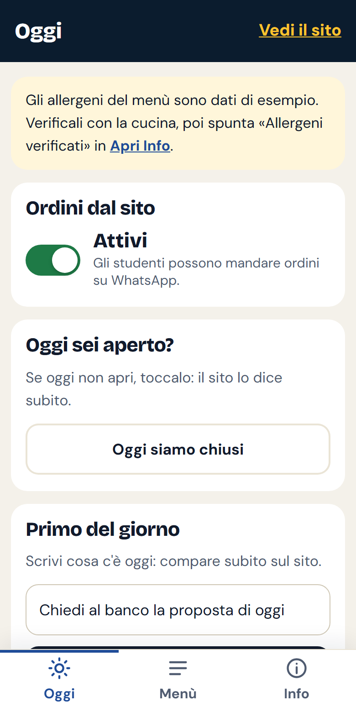
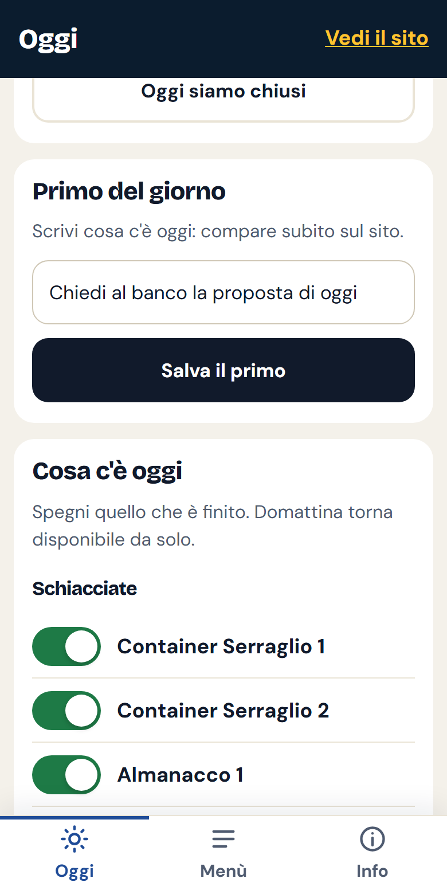
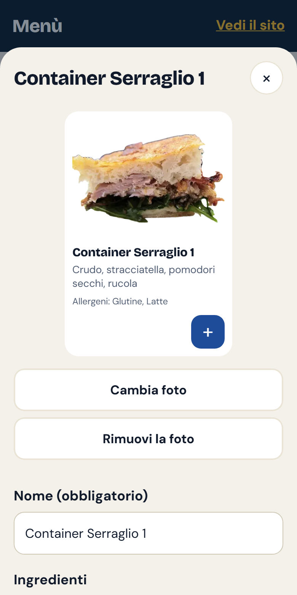
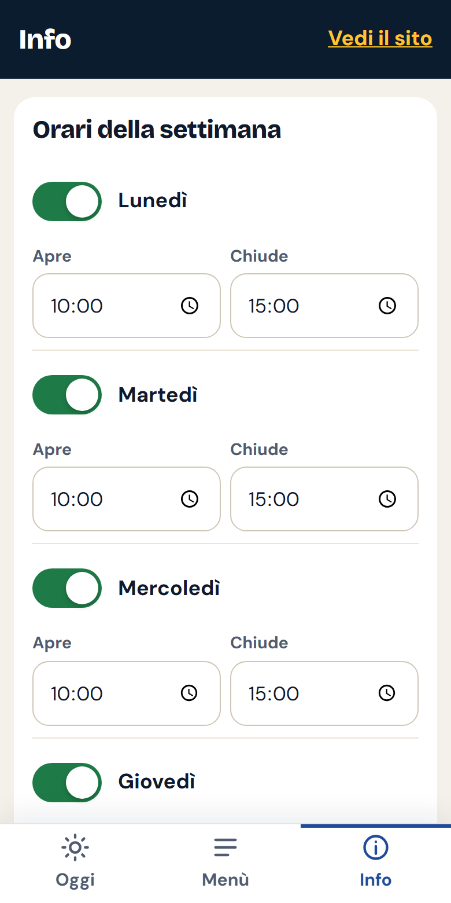

# Il pannello del locale — guida rapida

Il pannello si apre dal telefono su **containerserraglio.it/admin** (o
l'indirizzo del sito seguito da `/admin`). Conviene aggiungerlo alla schermata
Home: nel browser tocca *Condividi* o il menù ⋮ → *Aggiungi a schermata Home*.
Così si apre con un'icona, come un'app.

**Entrare:** scrivi il PIN di sei cifre. All'ultima cifra si entra da soli.
Su questo telefono resti dentro per 30 giorni.

Dopo ogni modifica compare in basso **«Salvato · ora»**: se lo vedi, è fatto.

---

## Ogni mattina: schermata «Oggi»

1. **Ordini dal sito.** Verde = gli studenti possono ordinare. Se c'è troppa
   gente o un problema, spegnilo: il sito resta visibile ma non lascia ordinare.
2. **Oggi siamo chiusi.** Se oggi non apri, toccalo: il sito scrive «Chiuso
   oggi». Lo stesso pulsante diventa «Riapri oggi».
3. **Primo del giorno.** Scrivi cosa c'è (es. *Pasta al ragù*) e tocca
   «Salva il primo».

4. **Cosa c'è oggi.** Quando una cosa finisce, spegni il suo interruttore: sul
   sito diventa «Finito per oggi». **Domattina torna disponibile da sola**, non
   serve ricordarsene.

## Gli ordini

Arrivano su **WhatsApp**, al numero scritto in Info → Contatti, con nome,
ora di ritiro, prodotti, totale e note. **Rispondi per confermare**: per lo
studente l'ordine è accettato quando gli rispondi. Si paga al ritiro.

Le chat degli ordini vanno cancellate entro 30 giorni (lo dice la privacy del
sito).

## Il menù: schermata «Menù»

- Tocca un prodotto per cambiare **nome, ingredienti, allergeni, prezzo**.
  Il prezzo vuoto vuol dire «prezzo della categoria».
- **Foto:** «Scatta o scegli una foto» apre la fotocamera. La foto viene
  ritagliata e alleggerita da sola. «Rimuovi la foto» rimette il disegno.
- **Mostra nel menù** spento: il prodotto resta qui ma sparisce dal sito
  (per i prodotti stagionali).
- Le frecce **↑ ↓** cambiano l'ordine in cui compaiono.
- «Modifica» accanto al titolo di una categoria cambia il prezzo di tutta la
  categoria.
- Per eliminare qualcosa il pannello chiede sempre conferma.

## Le cose che cambiano di rado: schermata «Info»

- **Orari della settimana** e **giorni di chiusura** (feste, ferie).
- **Contatti**, compreso il numero WhatsApp degli ordini. «Prova il numero
  WhatsApp» controlla che funzioni.
- **Recensioni Google:** voto e numero di recensioni, da aggiornare ogni tanto
  copiandoli dalla scheda Google.
- **Dati del locale:** ragione sociale, partita IVA, codice fiscale, PEC. Sono
  obbligatori nel sito: finché mancano il sito scrive «dato da completare».
- **Allergeni verificati con la cucina:** spuntalo dopo aver controllato gli
  allergeni di ogni prodotto.
- **Sicurezza:** cambia il PIN, vedi gli ultimi accessi, esci da tutti i
  telefoni (se ne perdi uno).

## Se qualcosa non va

| Problema | Cosa fare |
|---|---|
| «Sessione scaduta» | Rifai l'accesso con il PIN. |
| «Troppi tentativi» | Aspetta un quarto d'ora, oppure prova dal wifi del locale. |
| PIN dimenticato | Chiedi a chi gestisce il sito: lo reimposta in un minuto. |
| «Non sono riuscito a salvare» | Manca la connessione: riprova quando c'è campo. |
| Il sito non si apre | Avvisa chi gestisce il sito. |
